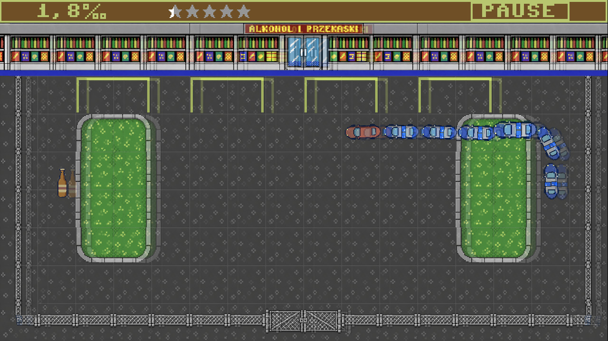

# DUI

A retro Snake-style arcade game for adults, set in a liquor-store parking lot.
Drive the red car, collect pickups, and grow a convoy of police cars behind you.
Keep clear of the fence, storefront, closed gate, and your own tail.
One crash ends the run.

## How to Play

The car keeps moving, so plan your turns and leave yourself an escape route.
Every beer, vodka shot, or bag of powder adds another police car to the convoy.
Your score counts all cars, including your own: start with one and fill all
five stars by reaching 84. Your alcohol level is shown separately in ‰.

As the alcohol level rises, double vision makes the parking lot harder to read.
Pickups can help you recover or make your next turn much more challenging.

## Pickups

| Item | Effect |
|---|---|
| Beer | Adds 0.2‰ and one police car. |
| Vodka | Adds 0.4‰ and one police car; shakes the playfield for 3 seconds. |
| Sausage | Removes 0.4‰, down to zero, without growing the convoy. |
| White powder | Adds one police car, hides double vision, shaking, and rainbows, and boosts speed to 1.2× for 10 seconds. |
| Mushroom | Reverses all directions, slows the car to 0.5×, and adds a moving rainbow for 10 seconds. |

Collecting the same timed pickup again refreshes its duration. Powder hides
the mushroom's rainbow, but its reversed controls still apply. Active-effect
icons blink beside the alcohol counter and flash faster during the last second.
Music speeds up and rises in pitch with powder, slows and drops with a
mushroom, and follows the combined 0.6× speed when both are active.

## Controls

- **Steer:** arrow keys or WASD; controller D-pad or left stick.
- **Pause:** Escape, controller Start / Back, or the PAUSE button.
- **Continue or restart:** choose RESUME or RETRY. RETRY clears the convoy
  and all effects for a fresh run.

The game also pauses when you switch away from its window.

## Development

`MonoGameLibrary` is a reusable DesktopGL library; `DUI.Game` references it,
and `DUI.Desktop` builds the executable and content. Mobile targets are not planned.

Run `dotnet run --project DUI.Desktop`. In Debug, **F12** toggles shader property
windows. Enable **Override values** to edit parameters while the game runs.
Shader source changes rebuild and reload automatically; `--no-reload` disables
the build watcher. Release builds have no active inspector or watcher.

[Project details and shader workflow](Docs/DETAILS.md)
